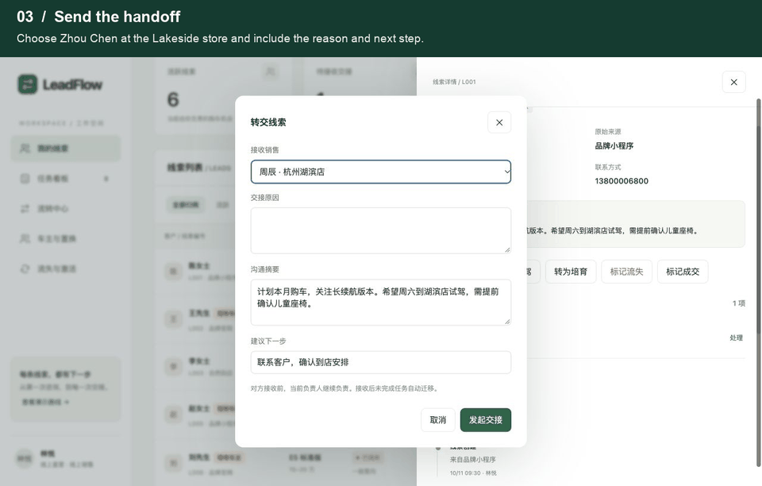

# LeadFlow

A workflow prototype for the online-to-store lead handoff in automotive retail: who owns a lead, whether they accepted it, and what happens next.

**[Live demo](https://dervishxj.github.io/leadflow/)** · **[Case study](https://dervishxj.github.io/leadflow/case-study/)**



## The problem

Most automotive sales teams already run a CRM. It stores leads and stages well. My hypothesis is that the handoff between online sales and stores is the weak point:

- Reassigning a lead is a field change, so nothing confirms the receiver accepted it.
- Customer context, such as a promised Saturday test drive, stays in chat history instead of the record.
- Open follow-ups don't move with the lead, so after a handoff the next step has no clear owner.
- Supervisors export to Excel to find stuck handoffs and uneven workloads.

These are hypotheses, not measured facts. The case study includes a pilot plan to test them.

LeadFlow is a prototype of this handoff layer. It is not a CRM replacement; in production it would ship as a module inside the existing CRM.

## What it does

| Rule | How the prototype enforces it |
|---|---|
| Handoffs must be accepted | A lead changes owner only when the receiver accepts. Until then the sender stays responsible. |
| Tasks move with the owner | Open follow-ups and the customer's context migrate to the new owner on acceptance. |
| Every active lead has a next step | A lead without a next task is flagged, and the supervisor dashboard tracks the count. |
| Timeouts escalate | Unaccepted handoffs and overdue tasks surface on the supervisor dashboard, with drill-down to the exact leads. |

It also includes an Excel import with column mapping, row validation and duplicate detection, an owner and trade-in flow, and reactivation of lost leads.

## Try it in 5 minutes

The interface is in Chinese, because the users are sales staff in China.

1. Click 重置演示 (reset demo) at the bottom right.
2. As 林悦 (online sales), open 陈女士 (Ms. Chen) and hand her over to 周辰 (store advisor).
3. Switch to 周辰 and accept. The context and task arrive with her.
4. Click + 1 天 (+1 day), then switch to 沈知行 (supervisor) to see timeouts on the dashboard.
5. Open 从 Excel 导入 (import from Excel) → 载入演示示例 (load sample) to see validation and duplicate detection.

## My role

I defined the problem framing, the four rules, the edge cases and the trade-offs. ChatGPT built the first clickable prototype, and Codex implemented fixes and the Excel import from my specs. The decisions and their costs are in the [case study](https://dervishxj.github.io/leadflow/case-study/).

## Limits

- Fictional data only. Actions are stored in the browser (localStorage).
- Not connected to a real CRM, DMS or service records.
- The rules have not been tested with real sales teams yet.

## Run locally

No build step. Serve the `dist` folder with any static server:

```bash
npx serve dist
```

Tests (Node 22+):

```bash
node test.mjs && node excel.test.mjs && node owners.test.mjs && node consistency.test.mjs
```

Case study copy lives in `dist/caseStudyContent.mjs`. After editing it, run `node scripts/build-case-study.mjs`.
